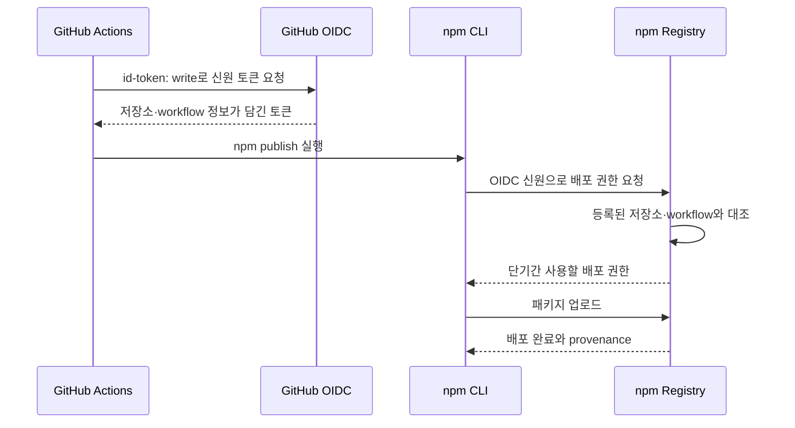

npm에 배포하는 CLI 세 개, `oci-cost-cli`와 `cc-usage-cli`, `codex-unlock`의 배포 방식을 차례로 확인했습니다. 릴리스는 GitHub Actions가 맡고 있었지만, 인증 단계에서는 모두 `NPM_TOKEN`을 `NODE_AUTH_TOKEN`으로 넘기고 있었습니다.

이번 작업은 토큰 유출 사고를 수습하기 위해 시작한 것은 아닙니다. GitHub secret에 장기 배포 토큰을 넣어두는 방식 대신, npm의 [Trusted Publisher](https://docs.npmjs.com/trusted-publishers)를 사용해 GitHub Actions가 OIDC로 신원을 증명하고 배포하도록 바꾸는 것이 목표였습니다. 그렇다고 설정을 바꾸자마자 기존 토큰부터 지울 수는 없습니다. 각 배포 경로가 실제로 동작하는지 확인한 다음 정리하기로 했습니다.

## 먼저, 세 패키지 설정은 서로 달랐습니다

세 패키지 모두 CI에서 `NPM_TOKEN`으로 인증했다는 점은 같았습니다. 다만 npm 계정의 2FA나 토큰 설정까지 똑같지는 않았습니다. `cc-usage-cli`의 Access 화면에는 “2FA 또는 2FA 우회용 granular token” 옵션이 선택돼 있었습니다. `codex-unlock`은 이번 작업에서 계정의 2FA 설정을 바꾸지 않았고, 기존 토큰 종류도 따로 확인하지 않았습니다. `oci-cost-cli` 역시 토큰의 세부 종류까지는 확인하지 않았습니다. 확인한 범위에서는 세 패키지 모두 토큰 유출 사고에 대응하기 위해 시작한 작업은 아니었습니다.

그리고 `id-token: write`가 있거나 `npm publish --provenance`를 실행한다고 해서 인증까지 OIDC로 바뀌는 것은 아닙니다. 예를 들어 `oci-cost-cli`는 기존에도 두 publish job에 `id-token: write`가 있었지만 실제 인증에는 `NPM_TOKEN`을 사용했습니다. provenance는 패키지가 어디서 만들어졌는지 보여주는 출처 증명이고, OIDC는 배포 권한을 얻는 인증 방식입니다. 둘은 관련은 있지만 같은 기능은 아닙니다.

Trusted Publisher에서는 npm에 저장소와 workflow 파일을 등록해 둡니다. 배포할 때 GitHub Actions가 OIDC 신원을 제시하면 npm이 등록된 정보와 맞는지 확인하고, 일치하면 단기간 사용할 수 있는 배포 권한을 발급합니다.

npm 문서 기준으로 필요한 최소 버전은 Node.js 22.14.0, npm 11.5.1입니다. GitHub Actions에는 `id-token: write` 권한이 필요하고, npm에 등록할 workflow 파일명도 실제 파일과 정확히 일치해야 합니다. 설정을 저장한 것만으로 연결 검증까지 끝나는 것은 아닙니다. 실제 publish를 해봐야 바인딩이 제대로 맞는지 알 수 있습니다.

## 저장소마다 배포 경로가 조금씩 달랐습니다

### `oci-cost-cli`: 자동 배포는 확인했지만, 수동 경로는 남아 있습니다

이 저장소에는 배포 경로가 두 개 있었습니다. 평소 릴리스는 `release-please.yml`, 특정 태그를 다시 올리는 수동 복구는 `publish.yml`이 맡았습니다. 둘 다 `NPM_TOKEN`을 사용했으므로, 처음 계획대로라면 npm에도 workflow별로 Trusted Publisher를 등록해야 했습니다.

[PR #51](https://github.com/abruption/oci-cost-cli/pull/51)에서는 두 workflow에서 토큰 참조와 `--provenance` 옵션을 없앴고, `npm publish --access public`은 유지했습니다. Node.js는 22에서 24로 올리고 릴리스 빌드의 npm 캐시도 껐습니다. `package.json`의 저장소 URL이 실제 GitHub 저장소와 맞는지도 확인했습니다. 테스트 77개는 통과했지만, 로컬에 `actionlint`가 없어 해당 검사는 실행하지 못했습니다. PR은 9월 27일 병합됐습니다.

처음 `release-please.yml` 연결을 입력했을 때는 PassKey 인증 화면까지 갔지만, 설정이 최종 저장됐는지는 확인하지 못했습니다. `publish.yml` 연결도 등록하지 않은 상태였습니다. 이후 실제 배포로 자동 릴리스 경로를 확인할 수 있었습니다. 9월 27일 `oci-cost-cli@0.5.0` 배포가 성공했고, npm provenance에는 저장소 `abruption/oci-cost-cli`, workflow `.github/workflows/release-please.yml`, 커밋 `3abc679`가 남았습니다. [Actions 실행 내역](https://github.com/abruption/oci-cost-cli/actions/runs/36298732101)과 [npm의 0.5.0 정보](https://www.npmjs.com/package/oci-cost-cli/v/0.5.0)도 대조했습니다. 설정 화면에 연결이 보이는 데서 그치지 않고, OIDC로 실제 배포된 기록까지 확인했습니다.

다만 수동 복구 경로까지 검증된 것은 아닙니다. `publish.yml` 연결을 따로 등록했는지, 그 workflow로 실제 배포할 수 있는지는 아직 확인하지 못했습니다.

### `cc-usage-cli`: 수동 재시도도 같은 workflow 안에서 처리했습니다

자동 릴리스뿐 아니라 `workflow_dispatch`를 이용한 수동 재시도도 모두 `release-please.yml` 안에서 처리했습니다. 그래서 npm에 등록할 workflow는 하나였고, PassKey 인증 뒤 연결이 저장된 것도 확인했습니다.

[PR #10](https://github.com/abruption/cc-usage-cli/pull/10)은 9월 27일 병합됐습니다. 두 배포 경로에서 `NPM_TOKEN`을 없애고 Node.js 24와 npm 11.5.1을 사용하도록 바꿨습니다. 릴리스 빌드 캐시를 끄고, 수동 배포 job에는 `contents: read`도 명시했습니다. 테스트 14개와 lint·검사가 통과했고, GitHub Actions의 Ubuntu/macOS/Windows 테스트도 모두 초록이었습니다.

PR이 병합됐다고 실제 publish까지 된 것은 아니었습니다. 병합 직후 Release workflow에서는 `npm publish`와 수동 배포 job이 모두 건너뛰어졌습니다. 당시 npm 최신 버전은 9월 6일에 올라간 `1.1.0`이었습니다. 같은 버전을 다시 올려 시험할 수는 없어 다음 버전 릴리스를 기다려야 했습니다. 여기까지는 9월 27일 14:57 KST에 확인한 내용입니다.

### `codex-unlock`: 오래된 Node 버전도 함께 정리했습니다

이 저장소에서는 `release-please.yml` 하나가 배포를 맡고 있었습니다. 기존 workflow는 Node.js 22.13.0과 `NPM_TOKEN`을 사용했습니다. npm Trusted Publisher 연결이 `release-please.yml`로 저장된 것은 확인했지만, 기존 토큰 종류나 계정의 2FA 상태까지 들여다보지는 않았습니다.

[PR #46](https://github.com/abruption/codex-unlock/pull/46)도 9월 27일 병합됐습니다. Node.js는 24, npm은 11.11.0으로 올렸고 `id-token: write`와 태그 checkout은 유지했습니다. 토큰 참조는 지웠지만 `--provenance`는 남겼습니다. 로컬 `npm ci`, 검사·lint·테스트 84개와 패키지 smoke test가 통과했고, PR CI의 20개 검사도 모두 초록이었습니다.

하지만 병합 직후 Release workflow에서는 publish job이 실행되지 않았습니다. 당시 최신 버전은 9월 23일에 올라간 `0.3.0`이었습니다. 이쪽도 실제 OIDC 배포와 provenance는 다음 릴리스에서 확인해야 했습니다. 이 내용 역시 9월 27일 14:57 KST 기준 스냅샷입니다.

## CI가 초록이어도 배포는 따로 확인해야 했습니다

세 PR이 병합되고 각 저장소의 테스트와 검사도 통과했지만, 그것만으로 OIDC 전환이 끝난 것은 아니었습니다. 처음 실행된 Release workflow에서는 세 저장소 모두 publish 단계가 건너뛰어졌습니다. Release Please가 새 릴리스를 만들지 않으면 publish 단계까지 가지 않을 수 있으므로, 이 결과만으로 배포에 성공했다고 볼 수는 없습니다.

이후 `oci-cost-cli`의 새 버전 `0.5.0`이 실제로 배포됐습니다. npm provenance에서 저장소와 workflow, 커밋을 확인하고 Actions 실행 기록과도 대조했습니다. 예전 버전에도 `--provenance`로 만든 기록은 있었지만, provenance만으로는 OIDC 인증을 사용했는지 알 수 없습니다. 이번에는 실제 publish 실행과 attestation을 함께 확인할 수 있었습니다.

반면 `cc-usage-cli`와 `codex-unlock`은 9월 27일 14:57 KST에 확인했을 때 새 릴리스가 없었습니다. 당시 최신 버전은 각각 `1.1.0`, `0.3.0`이었고, 실제 OIDC 인증은 아직 확인하지 못했습니다. 코드가 병합된 시점과 배포까지 검증된 시점을 구분해야 합니다.

## 토큰 정리는 배포를 확인한 뒤에

처음 정해 둔 순서는 간단했습니다. 패키지마다 실제 publish가 되는지 확인하고, provenance가 기대한 저장소와 workflow를 가리키는지도 살펴본 다음, npm의 기존 토큰 배포를 제한하고 GitHub의 `NPM_TOKEN` secret과 패키지별 토큰을 정리하기로 했습니다.

`oci-cost-cli`의 자동 릴리스 경로는 첫 실제 배포로 확인했습니다. 그래도 `publish.yml` 수동 경로는 따로 확인해야 하고, 성공한 뒤 토큰을 정리했는지도 이번에는 확인하지 않았습니다. `cc-usage-cli`와 `codex-unlock` 역시 다음 실제 릴리스를 확인해야 합니다. 설정 파일을 바꾸는 데서 끝내지 않고, 배포까지 확인한 다음 마무리하려고 합니다.

## 참고

- [npm Trusted Publishers 공식 문서](https://docs.npmjs.com/trusted-publishers)
- [`oci-cost-cli` PR #51](https://github.com/abruption/oci-cost-cli/pull/51) · [OIDC 배포 실행](https://github.com/abruption/oci-cost-cli/actions/runs/36298732101)
- [`cc-usage-cli` PR #10](https://github.com/abruption/cc-usage-cli/pull/10) · [관련 이슈 #9](https://github.com/abruption/cc-usage-cli/issues/9)
- [`codex-unlock` PR #46](https://github.com/abruption/codex-unlock/pull/46) · [관련 이슈 #45](https://github.com/abruption/codex-unlock/issues/45)
