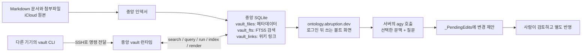

온톨로지라고 하면 거창한 지식 그래프를 떠올릴 수도 있습니다. 제가 만든 건 그보다는 실용적인 도구에 가깝습니다. Markdown 문서를 원본으로 두고, 검색과 정형 데이터는 SQLite에 맡겼습니다. 여러 기기에서 같은 DB를 조회할 수 있도록 명령어도 만들었습니다. 로그인 뒤에 쓰는 웹 화면에는 Antigravity CLI(`agy`)도 붙였습니다. 그러니 이 글은 노트를 AI에 넣은 챗봇 소개라기보다, 파일 원본을 검색하고 연결해 실제 작업에 쓰면서 겪은 시행착오 이야기입니다.

예전에 [Claude Code로 볼트를 자동화한 글](https://blog.abruption.dev/posts/Obsidian-Claude-Code-Vault-Automation/)에서 Skills와 Rules로 반복 작업을 어떻게 묶었는지 썼습니다. 이번에는 그보다 아래쪽 이야기를 해보려 합니다. 파일과 DB가 각각 무슨 일을 맡는지, 검색은 왜 가끔 엉뚱하게 실패했는지, AI에게 문서 수정을 부탁할 때는 어디까지 허용했는지 정리했습니다.

## 파일은 원본, DB는 검색과 정형 데이터 쪽

문서와 첨부파일은 Markdown 볼트에 둡니다. SQLite는 파일을 찾을 인덱스와 정형 데이터를 맡습니다. 문서 제목이나 링크를 고쳐도 원본이 DB로 옮겨가는 건 아닙니다.

검색 인덱스 안에서도 역할은 나뉩니다.

| 테이블 | 하는 일 |
|---|---|
| `vault_files` | 파일 경로, 제목, 분류 같은 메타데이터 |
| `vault_fts` | 제목과 본문을 대상으로 한 SQLite FTS5 전문 검색 |
| `vault_links` | 문서 안의 위키 링크를 해석해 저장한 관계 |

`vault_fts`가 문서 사이의 의미 관계까지 찾아주는 건 아닙니다. “이 단어가 들어간 파일이 뭐지?”는 FTS가 빠르게 찾아주고, “이 문서가 저 문서와 어떻게 연결돼 있지?”는 사람이 문서에 남긴 링크를 `vault_links`가 따로 보관합니다. 검색 인덱스와 링크 그래프는 한 덩어리가 아닙니다.

구조를 아주 단순하게 그리면 이렇습니다.



## 기기마다 DB를 들고 있던 구조를 접었다

처음부터 중앙 DB였던 건 아니었습니다. 문서가 여러 기기 사이를 오가기 시작하면서 SQLite까지 각 기기에서 동기화하는 방식은 오래 버티기 어렵겠다는 생각이 들었습니다. 같은 볼트를 보고 있어도 DB 파일은 서로 다른 시점일 수 있었고, 문서와 DB를 함께 맞추는 일도 늘었습니다.

2026년 9월 11일 마이그레이션 기록을 보면, 지금 구조의 원칙은 단순합니다. 문서와 첨부파일은 iCloud에 두고 SQLite DB는 중앙 한 곳에서만 씁니다. 다른 Mac이나 서버에서 `vault`를 실행하면 그 기기에서 DB를 여는 대신 중앙 런타임으로 명령을 보냅니다. DB를 기기마다 복사하거나 동기화하지 않습니다.

이렇게 바꾸고 나니 기기마다 DB가 달라지는 일은 줄었습니다. 대신 중앙 런타임에 연결되지 않으면 조회와 기록도 잠시 멈춥니다. iCloud에 올린 문서가 아직 반대편에 도착하지 않았다면 인덱싱할 때도 그 상태를 확인해야 합니다. 동기화가 늦다고 기기별 SQLite를 임시 정답으로 쓰지는 않습니다.

## `vault`는 DB에 가는 좁은 입구다

`vault`는 SQL 콘솔이나 범용 원격 셸이라기보다, 자주 쓰는 일을 몇 가지 명령으로 정해 둔 전달기입니다.

```text
vault search "검색어"
vault query --sql "SELECT ..." --table
vault run <등록된 작업> <인자>
vault index
vault render
vault status
vault result <요청 ID>
```

`query`는 `SELECT`나 `WITH ... SELECT`로 읽기만 합니다. 기록은 미리 등록해 둔 작업만 `run`으로 실행할 수 있습니다. Mac에서 `vault index`를 실행하면 바뀐 파일의 해시도 중앙으로 보내 서로 같은 파일인지 확인합니다. iCloud 전파가 끝나지 않았으면 `SYNC_PENDING`으로 멈춥니다. 결과는 stdout에 JSON으로, 진단 메시지는 stderr로 보냅니다. 자동화가 결과를 읽는 통로와 사람이 실패 원인을 찾는 통로를 나눠 둔 셈입니다.

운영하다 보니 “명령이 끝났나?”만 보고 성공 여부를 판단하면 안 된다는 걸 알게 됐습니다. 네트워크가 끊기거나 시간이 초과돼도 DB 쓰기까지 실패했다고 단정할 수는 없습니다. 이럴 때는 새 요청을 보내기 전에 같은 요청 ID로 `vault result`부터 확인합니다. 같은 작업을 새 ID로 덜컥 다시 실행하면 기록이 중복될 수 있습니다.

DB 저장과 Markdown 반영은 별개의 상태입니다. 응답의 `db_committed`는 DB에 기록됐는지, `document_status`는 생성 블록이 문서에 반영됐는지를 알려줍니다. DB 저장은 끝났는데 문서 상태가 `pending`이면 기록 작업을 다시 하지 않고 `vault render`만 재시도합니다. 인덱싱 결과가 `SYNC_PENDING`이면 iCloud 전파가 끝난 뒤 다시 확인합니다.

결국 이 명령 계약은 인터페이스를 예쁘게 꾸미기보다 실패 상황을 덜 헷갈리게 하는 데 초점을 두었습니다. 어디까지 저장됐는지 나눠 보여주고 결과를 확인할 방법을 두면, “안 된 것 같은데 한 번 더 실행해 볼까?” 하는 일을 줄일 수 있습니다.

## 하이픈 하나가 검색을 막았다

`oci-cost-cli`라는 이름이 볼트에 분명 있는데 `vault search`로는 찾지 못한 적이 있습니다. 처음엔 문서가 인덱스에서 빠졌는지 의심했는데, 원인은 검색어를 FTS5 `MATCH`에 넘기는 방식에 있었습니다.

FTS5 쿼리에서 따옴표 없는 bareword는 아무 문자나 담을 수 있는 일반 문자열이 아닙니다. 영문자·숫자·밑줄·비 ASCII 문자 외의 문자가 들어가면 쿼리 문자열로 인용해야 합니다. 그래서 `oci-cost-cli`를 따옴표 없이 넘기면 하이픈이 든 제품명 그대로 처리되지 않습니다. 그때는 문서가 있는데도 검색 결과가 0건으로 나왔습니다. [SQLite 공식 문서의 FTS5 문자열 문법](https://www.sqlite.org/fts5.html#fts5_strings)에도 이 내용이 나와 있습니다.

수정한 코드는 검색어를 공백으로 나누고 각 토큰을 큰따옴표로 감싸 FTS5에 넘깁니다. 토큰 안에 따옴표가 들어 있어도 쿼리가 깨지지 않도록 따옴표를 한 번 더 처리합니다. 여러 단어를 검색할 때 각 토큰 사이의 기존 AND 동작도 유지했습니다.

여기서 “하이픈을 보존한다”는 말은 FTS 인덱스에 하이픈이 특별한 토큰으로 저장된다는 뜻이 아닙니다. 기본 토크나이저는 문장부호를 구분자로 볼 수 있어서 `oci-cost-cli`는 `oci`, `cost`, `cli` 순서의 토큰 구문으로 검색됩니다. 따옴표는 입력이 FTS 쿼리 문법으로 잘못 해석되지 않게 해 줄 뿐, 글자 단위로 정확히 일치하는 검색은 아닙니다. 여러 토큰을 공백으로 나열하면 FTS5가 암묵적인 AND로 처리한다는 점도 [공식 쿼리 문법](https://www.sqlite.org/fts5.html#fts5_boolean_operators)에 나와 있습니다.

2026년 7월 13일 수정 기록에는 이 변경 뒤 다중 키워드 검색의 회귀 확인을 통과했다고 적혀 있습니다. 현재 인덱서 코드도 공백 토큰을 인용하는 같은 방식으로 검색어를 만듭니다. 이 일을 겪고 나서는 검색 결과가 0건이어도 문서가 없다고 바로 결론 내리기보다, 검색어가 쿼리 문법에 어떻게 전달되는지 먼저 보게 됐습니다.

## 온톨로지를 AI에 전부 맡기지는 않았다

`ontology.abruption.dev`는 로그인한 뒤 볼트 문맥을 살펴볼 수 있는 화면입니다. 여기에 `agy`를 붙인 건 노트를 통째로 대화창에 복사하려는 게 아닙니다. 서버가 사용자가 고른 문서와 허용된 문맥을 준비하고, 그 범위 안에서 질문하거나 검토 요청을 만들 수 있게 하려는 구성입니다.

제안 권한이 켜진 계정에서 문서를 고쳐 달라고 하면 원본 파일을 바로 덮어쓰지 않고 `_PendingEdits`에 변경 제안서를 남기도록 안내합니다. 제안서에는 대상 문서와 바꾸려는 내용, 이유를 적고, 사람의 검토를 거친 뒤 따로 반영합니다. 계정마다 이 기능의 허용 범위는 다를 수 있습니다. 그리고 이건 앱 정책과 프롬프트에 둔 작업 경계입니다. 운영체제 수준의 샌드박스가 `agy` 프로세스를 완전히 격리한다고 볼 수는 없습니다. 검토 단계를 두는 것과 프로세스 권한을 기술적으로 차단하는 건 별개의 문제입니다.

`agy -p`는 대화 상태를 자체적으로 보존하지 않습니다. 그래서 사이트에서 이전 대화 일부(최대 20개 메시지)를 다시 구성해 다음 프롬프트에 붙입니다. 2026년 7월 22일에는 프롬프트를 stdin으로 보내는 `-p -` 방식이 실제 입력을 읽지 않는다는 걸 확인했습니다. 이후 질문을 `-p` 인자로 직접 넘기도록 바꿨습니다. 모델을 바꾸기 전에 입출력 경계부터 확인해야 했던 버그였습니다.

긴 입력과 첨부에는 한도가 있습니다. 2026년 9월 28일 배포 기록과 당시 서버 코드를 대조해 보면, 일반 메시지는 32KiB까지고 더 긴 텍스트는 최대 1MiB짜리 텍스트 첨부로 보냅니다. 일반 파일은 하나당 20MiB까지 올릴 수 있고, 한 요청에 첨부 ID는 최대 20개입니다. `agy -p`에 넘기는 최종 프롬프트는 96KiB 아래로 제한합니다. 길어지면 오래된 대화부터 덜어냅니다. 그래도 현재 질문이 들어가지 않으면 조용히 자르는 대신 요청을 거절합니다.

첨부를 모두 같은 방식으로 보관하는 것도 아닙니다. 2026년 9월 28일 서버 코드 기준으로 일반 채팅 첨부는 대화에 연결돼 다음 턴에도 다시 참조할 수 있고, 대화를 삭제하면 함께 정리됩니다. 반면 9월 16일 기록에는 `_PendingEdits` 검토에 필요한 증거 자료를 따로 보존하는 경로가 나옵니다. 두 첨부를 같은 종류로 보면 안 됩니다.

2026년 9월 28일 배포 소스를 보면, 서버는 AGY의 `text_delta` 이벤트를 SSE로 전달합니다. 긴 요청 중 연결이 한동안 조용해 중간 프록시가 끊지 않도록 15초마다 heartbeat도 보냅니다. 도착한 텍스트 조각을 전달하는 방식이지, 모델의 모든 토큰이 일정한 속도로 실시간 전송된다는 보장은 아닙니다.

이 경계가 제대로 작동하지 않은 적도 있습니다. 2026년 9월 5일 `agy` 1.1.27 장애 기록을 보면, 도구의 산출물 경로 규칙 때문에 `_PendingEdits` 쓰기가 거부될 수 있었고 실패가 간헐적인 긴 대기로 나타났다고 합니다. 당시에는 stderr를 버리지 않고 실패 원인이 드러나게 조치했습니다. 이 기록만으로 경로 규칙 자체가 수정됐다거나 이후 버전에도 같은 문제가 있다고 단정할 수는 없습니다.

## 검색, 관계, 승인은 서로 다른 문제였다

돌아보니 어느 한 도구가 모든 문제를 해결해 주지는 않았습니다. SQLite FTS5는 문서에서 단어를 찾고, `vault_links`는 사람이 남긴 연결을 저장합니다. `vault`는 그 데이터에 안전하게 접근할 명령 경계를 만들고, 웹 화면의 `agy`는 선택한 문맥을 읽어 답이나 검토 제안을 만듭니다. 제안이 원본을 바로 바꾸지 않도록 마지막에 확인하는 건 여전히 사람 몫입니다.

중앙 DB를 쓰면서 기기별 데이터가 갈라지는 일은 줄었습니다. 대신 네트워크와 iCloud 전파, 문서 렌더링 상태를 더 꼼꼼히 살펴야 했습니다. 검색 인덱스를 만들었다고 문서 구조가 필요 없어지는 것도 아니었습니다. 각 계층의 원본과 책임 범위를 나눠 둔 덕분에 운영할 때 덜 헷갈렸습니다.

기록마다 시점도 따로 봐야 합니다. 중앙 DB 구조는 2026년 9월 11일 기록, 하이픈 검색 수정은 7월 13일 기록, `agy` 프롬프트 전달 수정은 7월 22일 기록을 근거로 했습니다. 사이트의 입력·첨부 한도는 9월 28일 배포 버전의 코드 기준입니다. 10월 19일에 로그인된 사이트가 실제로 어떻게 동작하는지는 따로 확인하지 않았습니다. 9월 5일 `agy` 장애 기록 역시 그때의 상태를 말해 줄 뿐입니다. 이 기록들만으로 오늘의 운영 상태 전체를 보증할 수는 없습니다.

## 참고

- [앞선 글: Obsidian 볼트를 Claude Code로 자동화한 이야기](https://blog.abruption.dev/posts/Obsidian-Claude-Code-Vault-Automation/)
- [SQLite FTS5 공식 문서 — 문자열 문법](https://www.sqlite.org/fts5.html#fts5_strings)
- [SQLite FTS5 공식 문서 — Boolean 연산과 암묵적 AND](https://www.sqlite.org/fts5.html#fts5_boolean_operators)
