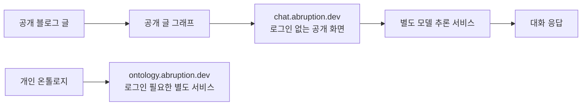

`ontology.abruption.dev`와 `chat.abruption.dev`는 이름이 비슷하다 보니 같은 서비스의 로그인 화면과 게스트 화면처럼 보일 수도 있습니다. 하지만 실제로는 쓰임새가 다릅니다. 하나는 로그인한 뒤 개인 볼트를 다루는 곳이고, 다른 하나는 공개 블로그 글을 그래프로 둘러보고 질문하는 서비스입니다.

공개 챗봇을 만든다고 개인 온톨로지까지 열어두고 싶었던 건 아닙니다. 그래서 화면 색이나 모델 선택기보다 먼저 정한 게 데이터 경계였습니다. 공개 그래프에는 무엇을 넣고, 개인 볼트와는 어떻게 나눌지부터 생각했습니다.

## 공개할 것은 블로그 글뿐

2026년 7월 23일 설계 기록을 보면 `chat.abruption.dev`는 로그인 없이 쓰는 공개 그래프 챗봇이고, 지식원은 공개 블로그 글로 한정돼 있습니다. 개인 볼트용 `ontology.abruption.dev`와는 인스턴스도 데이터셋도 분리했습니다. 공개 챗봇이 개인 볼트에 접근하는 구조가 아니라는 뜻입니다. 그러니 “개인 온톨로지 앱의 익명 모드”라고 부르면 정확하지 않습니다.

2026년 9월 28일 도메인 기록에는 공개 서비스가 운영 중이라고 나옵니다. 그래프는 당시 공개 글 51개를 바탕으로 했다고 합니다. 물론 이건 그 시점의 스냅샷이라 지금도 글이 51개라는 뜻은 아닙니다. 언제 처음 공개했는지도 확인한 문서만으로는 알 수 없었습니다.

두 서비스가 화면 코드를 일부 같이 쓴다고 데이터까지 공유하는 것은 아닙니다. 공개 화면은 별도 인스턴스와 공개 데이터셋을 쓰고, 채팅 요청은 또 다른 추론 서비스로 전달합니다. 이런 구분을 문서와 구성에 분명히 남기는 편이 “실수로 개인 볼트까지 공개하지 않겠다”는 말보다 훨씬 구체적인 경계가 됐습니다.

## 그래프 화면을 만든 것과 그래프의 의미를 설명하는 건 다르다

공개 그래프 화면에는 블로그 글을 나타내는 노드와 카테고리별 색 구분이 있습니다. 2026년 9월 5일 화면 기록에는 노드 51개가 언급돼 있고, 일곱 카테고리의 색을 다듬어 공개 화면에 적용한 과정도 남아 있습니다. 9월 16일에는 글 본문을 보는 화면을 개선해 공개 인스턴스에 반영했습니다. 다만 이때 백엔드 동작까지 바뀐 것은 아닙니다.

그렇다고 그래프의 의미까지 다 확인된 것은 아닙니다. 제가 본 기록만으로는 노드 하나가 글 하나와 정확히 대응하는지, 선이 어떤 규칙으로 그려지는지 알 수 없었습니다. 연결이 태그를 뜻하는지 링크를 뜻하는지도 확인되지 않았습니다. 그래서 이 화면을 모든 글의 의미 관계를 분석한 지식 지도라고 부르지는 않으려 합니다. 확인된 것은 공개 글을 그래프 형태로 둘러보고 카테고리를 구분해 볼 수 있다는 정도입니다.

## 모델 선택기가 있다고 답변까지 검증된 건 아니었다

채팅 요청은 NVIDIA NIM을 거쳐 모델로 전달합니다. 당시 연결한 것은 무료 endpoint였지만, 무료 endpoint는 제공 모델이 바뀌거나 아예 내려갈 수 있습니다. 한 번 연결했다고 같은 모델을 계속 쓸 수 있는 것은 아닙니다.

2026년 9월 23일 기록에는 최근 36시간 안에 상태를 확인한 모델만 목록에 보여주고, 상태 정보가 오래되면 안전하게 실패하도록 했다고 나옵니다. 자동으로 다른 모델을 골라 쓰지도 않습니다. 목록에 모델 이름이 보인다고 실제 답변까지 확인된 것은 아닙니다. 같은 기록에 따르면 Gemma 모델 추론 시험은 60~90초 뒤 시간 초과로 끝났고, 답변이 제대로 나오는지 확인하지 못했습니다.

2026년 9월 28일 기록에는 사이트가 공개 운영 중이라고 나옵니다. 다만 2026년 10월 19일 현재 무료 모델 endpoint에 접근할 수 없어 채팅 답변이 나오지 않는다는 것은 사용자가 확인해 준 상태입니다. 그래프 화면이 열리는지와는 별개의 문제입니다. 사이트가 열리는 것, 그래프가 보이는 것, 챗봇이 답하는 것. 이 셋은 따로 확인해야 했습니다.

방문자가 노드를 고르거나 글 본문을 열었을 때 어떤 내용이 모델에 전달되는지, 대화 기록을 얼마나 보존하는지까지는 기록에서 확인하지 못했습니다. 그래서 선택한 글만 프롬프트에 들어간다거나 모델이 그래프 전체를 알아서 검색한다고 단정하지 않으려 합니다.

그래서 이 글은 챗봇 완성 소식보다는, 공개 그래프와 개인 볼트를 나누고 무료 endpoint의 변동까지 염두에 두게 된 과정에 가깝습니다. endpoint 상태는 사용자가 확인한 내용을 반영했을 뿐, 제가 따로 시험해 본 것은 아닙니다. 모델 제공자의 요청 보존·학습 정책도 확인하지 않았습니다. 공개 글만 쓰도록 설계했다는 기록이 있다고 해서 모든 처리 단계에서 개인정보가 전혀 전송되거나 저장되지 않는다고 보장할 수는 없습니다.

## 공개 범위를 정하는 일이 먼저였다

돌아보면 이 프로젝트에서 가장 중요했던 결정은 그래프 라이브러리나 모델을 고르는 것보다 공개할 데이터의 범위를 정하는 일이었습니다. 개인 볼트 앱의 화면을 재사용하더라도 공개 인스턴스는 공개 블로그 데이터만 보도록 나눴습니다. 공개 그래프가 개인 온톨로지의 축소판이나 익명 미러가 되지 않게 하려는 선택이었습니다.

기록으로 따라갈 수 있는 흐름은 7월 23일 공개 챗봇 설계, 9월 초 UI 적용, 9월 16일 본문 보기 개선, 그리고 9월 28일 공개 운영 스냅샷까지입니다. 그사이에 모델 응답 검증까지 끝났다고 볼 근거는 없습니다. 나중에 이 글을 고친다면 화면을 배포했다는 얘기와 별도로, 실제 질문과 답변이 오가는 경로를 다시 시험한 결과부터 보태고 싶습니다.

## 참고

- [공개 블로그 그래프 챗봇](https://chat.abruption.dev)
