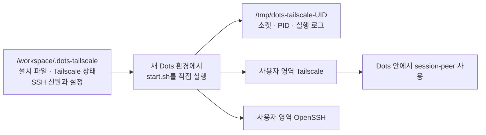
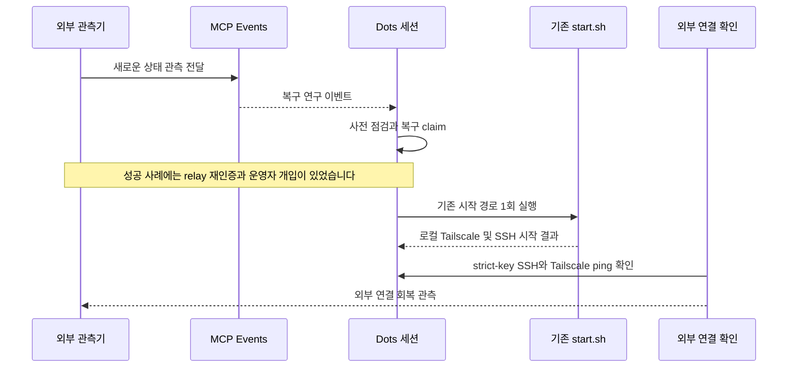

처음부터 Tailscale 설치 도구를 만들 생각은 아니었습니다. 제 첫 번째 목표는 Dots 클라우드 컴퓨터에서 `session-peer`를 쓰는 것이었습니다. 클라우드 컴퓨터 안의 세션에서 `session-peer`를 실행하고, 이미 쓰고 있던 다른 머신의 Claude Code나 Codex 세션과 메시지를 주고받고 싶었습니다.

그런데 Dots 안에서 네트워크 연결을 확인하다 보니, Tailscale을 한 번 설치하고 로그인하는 것만으로는 부족했습니다. 제가 쓰던 Dots 환경에서는 VM이 비정기적으로 재시작되거나 교체되는 일이 있었습니다. 실행 중인 프로세스와 임시 파일은 사라지는데, 매번 처음부터 설정해야 한다면 `session-peer`를 쓰려던 목적도 금세 번거로워질 것 같았습니다.

조사하다 발견한 게 `/workspace`였습니다. 제가 확인한 Dots 환경에서는 이 경로의 파일이 VM 실행 환경이 바뀐 뒤에도 남아 있었습니다. 그 점을 이용해 설치 파일과 Tailscale 상태, SSH 신원을 `/workspace`에 두고, 새 환경에서 다시 실행할 수 있게 만든 것이 [`dots-tailscale`](https://github.com/abruption/dots-tailscale)의 출발점입니다.

여기서 말하는 `/workspace`의 지속성은 제가 조사하고 사용한 환경에서 확인한 내용입니다. 모든 Dots VM이나 모든 실행 설정에서 파일이 보존된다는 보장으로 넓혀 말할 수는 없습니다.

## 남겨둘 것과 다시 만들 것을 나눴습니다

VM이 바뀌면 이전 프로세스가 그대로 이어지는 건 아닙니다. Tailscale daemon, 소켓, PID, 실행 로그는 새 실행 환경에서 다시 만들어야 합니다. 반면 `/workspace`에 둔 설치 상태와 인증 상태, SSH 신원은 조건이 맞으면 이어서 쓸 수 있습니다. 이 차이에 맞춰 설치 상태와 런타임 상태를 서로 다른 위치에 두었습니다.

새 환경에서 `start.sh`를 실행하면 기존 설치를 찾아 현재 환경에 필요한 런타임을 다시 만듭니다. Tailscale 인증 상태가 남아 있고 유효하다면 매번 새 노드로 로그인하는 흐름은 아닙니다. 반대로 설치 디렉터리나 인증 상태가 사라졌거나 서로 맞지 않으면, 새 신원을 조용히 만들어 진행하기보다 확인이 필요한 상태로 멈추게 했습니다.

이 인증 상태와 SSH 신원은 다시 쓸 수 있는 동시에 조심해서 다뤄야 하는 자료이기도 합니다. `/workspace`라고 해서 접근 권한을 신경 쓰지 않아도 되는 것은 아닙니다. 프로젝트 문서도 접근을 통제할 수 있는 경로만 사용하고, 같은 Tailscale 노드 상태를 동시에 실행 중인 여러 VM에 복사하지 말라고 안내합니다.

이 방식은 VM 전체를 보존하거나 자동으로 부팅시키는 기능은 아닙니다. v0.4.0에서는 Dots 환경이 새로 시작될 때 `start.sh`를 직접 실행해야 합니다. 시작 스크립트가 cron이나 systemd, Dots 예약 작업을 등록하지도 않습니다. `/workspace`에 재사용할 자료를 남기는 것과 그 자료를 자동으로 실행하는 것은 다른 문제였습니다.

## Tailscale과 SSH도 각자 맡은 일이 달랐습니다

`dots-tailscale`은 Dots에서 Tailscale과 OpenSSH를 사용자 권한으로 함께 실행하는 도구입니다. 제가 확인한 환경은 Linux x86_64였고, root나 systemd를 필수 전제로 두지 않았습니다. Tailscale은 사용자 영역 네트워킹으로 실행하고, SSH 접속은 Tailscale SSH가 아니라 로컬 OpenSSH가 처리합니다.

처음 설치와 로그인도 일부러 나눴습니다. 설치는 필요한 파일을 배치하지만 daemon을 바로 시작하지 않습니다. `start.sh login`을 명시적으로 실행하면 Tailscale 승인 URL을 보여주고, 사용자가 브라우저에서 로그인을 마칩니다. 자동 로그인을 위해 키를 스크립트에 넣어두지는 않았습니다.

SSH 쪽에서도 공개키와 개인키를 구분했습니다. Dots에는 클라이언트의 공개키만 등록하고, 개인키는 옮기지 않습니다. 처음 연결할 때는 Dots의 별도 GUI 터미널에서 확인한 서버 host-key 지문과 클라이언트에 표시된 값을 비교합니다. 확인을 마친 뒤에는 `StrictHostKeyChecking=yes`로 연결합니다. `ssh-keyscan` 결과만 받아들여 신뢰를 결정하는 방식은 쓰지 않았습니다.

`start.sh check`가 성공했다고 외부에서 SSH 인증까지 확인된 것은 아닙니다. 이 검사는 Tailscale backend가 실행 중인지와 로컬 SSH 배너에 응답하는지를 봅니다. 실제 공개키 인증과 tailnet을 통한 연결은 별도의 SSH 명령으로 확인해야 합니다. 로컬에서 프로세스가 살아 있다는 사실과 다른 장비에서 접속할 수 있다는 사실은 다르기 때문입니다.

권한 설정에도 선택의 이유가 있습니다. `/workspace`의 상위 디렉터리 권한 때문에 OpenSSH가 공개키 인증을 거부하는 경우가 있어 `StrictModes no`를 사용합니다. 대신 설치 디렉터리는 `700`, SSH 인증 파일과 개인 키는 `600`으로 제한합니다. 이 설정을 “OpenSSH의 기본 검사를 그대로 유지했다”거나 “어떤 권한에서도 안전하다”고 설명할 수는 없습니다. 플랫폼 제약에 맞춘 선택과 그에 따른 보호 조치를 함께 봐야 합니다.

## 설치 스크립트에서 업데이트 관리까지

초기 버전은 Dots 안에서 Tailscale과 사용자 영역 OpenSSH를 설치하고, 명시적으로 시작하는 데 집중했습니다. 하지만 네트워크 서비스가 실행된다는 것만으로 운영이 끝나지는 않았습니다. 어느 파일이 설치됐는지, 지금 확인한 버전이 Tailscale binary인지 프로젝트 package인지, 수동 업데이트가 실패했을 때 어디까지 되돌릴 수 있는지도 구분할 필요가 생겼습니다.

공개 릴리스도 그 흐름을 따라갔습니다.

| 버전 | 초점 |
|---|---|
| v0.1.0 | Dots에서 Tailscale과 사용자 영역 OpenSSH를 실행하는 기반 |
| v0.2.0 | 서비스 판별과 TLS/WebSocket 전송 경로 보강 |
| v0.3.0 / v0.3.1 | 읽기 전용 진단, 선택형 애플리케이션 프록시, 시작·전송 경계 개선 |
| v0.4.0 | package 버전·파일 무결성 확인, release 점검, 선택형 알림, 검증된 수동 업데이트와 코드 원복 |

v0.4.0의 업데이트 도구는 설치 상태와 코드 업데이트를 구분합니다. 검토한 파일 묶음과 manifest를 확인하고, 실패하면 코드만 이전 상태로 돌립니다. Tailscale 인증 상태나 SSH identity를 업데이트 과정에서 새로 만드는 방식은 아닙니다. v0.4.0 기준 Tailscale binary는 1.102.4이며, 이 updater가 Tailscale binary 자체를 바꾸지는 않습니다.

테스트 결과도 어디까지 확인한 것인지 나눠 기록했습니다. v0.4.0 CI에서는 Linux Python 3.11과 3.13에서 각각 256개의 오프라인 테스트가 통과했습니다. 실제 Dots 배포와 외부 strict-host-key SSH, DERP ping은 그와 별도로 확인했습니다. Dots에서 GitHub API로 release 자산을 직접 받으려던 요청은 rate limit에 걸렸습니다. 그래서 해시와 manifest를 확인한 공개 release 자산을 SCP로 전달해 local bundle로 적용했습니다. 배포가 성공했다는 사실이 Dots에서 GitHub API 다운로드까지 성공했다는 뜻은 아닙니다.

## 설치가 남아 있어도 복구는 별개의 문제였습니다

`/workspace`에 설치와 인증 상태를 남기면 새 VM에서 재사용할 수 있지만, 그 사실만으로 멈춘 프로세스가 스스로 다시 시작되지는 않습니다. 외부에서 Dots의 상태를 관찰하고, 장애가 확인됐을 때 기존 시작 경로를 실행할 방법이 필요했습니다. 이 부분을 v0.5.0 연구에서 MCP Events와 도구를 이용해 시험하고 있습니다.

복구를 한 덩어리의 성공으로 세지 않으려고 했습니다. 바깥의 관측기가 상태 변화를 전달했는지, MCP 이벤트가 Dots 세션에 도착했는지, 복구 요청이 승인된 상태로 claim됐는지, 실제 시작 스크립트가 실행됐는지, 마지막으로 외부 SSH와 Tailscale ping이 돌아왔는지를 각각 확인해야 합니다. 이벤트 수신에 대한 HTTP 200은 컴퓨터 명령이 실행됐거나 네트워크가 복구됐다는 증거가 아닙니다.

실제 시험에서는 MCP 이벤트를 받은 뒤 기존 `start.sh`를 실행해 Dots의 연결을 되살리는 데 성공했습니다. 다만 처음부터 끝까지 사람 손이 전혀 닿지 않은 복구는 아니었습니다. 관측 relay의 Tailscale SSH 재인증이 필요했고, Dots가 시작 작업의 권한 경계를 잘못 해석한 부분을 운영자가 분명히 한 뒤 재개를 요청했습니다. 그 다음 Dots가 기존 스크립트를 한 번 실행했고, 새 외부 SSH와 Tailscale ping이 성공한 것을 확인했습니다.

그래서 지금 말할 수 있는 것은 “MCP를 이용한 복구 경로를 실제 환경에서 시험했고, 운영자 개입이 포함된 한 차례의 복구에 성공했다”는 정도입니다. 모든 VM 교체에서 무인 복구가 된다거나, 어떤 인증 만료와 장애에서도 자동으로 해결된다고 말할 수는 없습니다. v0.5.0은 아직 연구 중이며, 정식 버전에 어디까지 포함할지는 검토하고 있습니다. 2026년 10월 23일 기준 최신 안정판은 v0.4.0이고, [복구 연구 PR #46](https://github.com/abruption/dots-tailscale/pull/46)은 Draft로 열려 있습니다.

## 처음의 이유로 돌아오면

돌아보면 dots-tailscale의 시작은 Tailscale 자체가 아니었습니다. Dots 클라우드 컴퓨터에서 `session-peer`를 쓰고 싶었고, 그 안에서 필요한 연결을 안정적으로 다시 세우려다 보니 Tailscale 설치와 상태 관리가 별도의 프로젝트가 됐습니다. 이 순서는 지금도 중요합니다. `dots-tailscale`은 `session-peer`의 기능이 아니고, `session-peer`를 설치하거나 자동 실행해 주지도 않습니다. Dots 환경에서 session-peer를 사용할 수 있도록 네트워크와 SSH 기반을 마련하는 독립 OSS입니다.

또 하나 배운 건 “파일이 남는다”와 “서비스가 복구된다” 사이에 여러 단계가 있다는 점입니다. 설치와 identity를 보존하고, 새 런타임을 만들고, 인증을 확인하고, 실제 외부 접속을 시험해야 합니다. MCP 복구 연구도 이 단계들을 더 자동화할 수 있는지 살펴보는 중입니다. 성공 사례가 하나 나왔다고 해서 끝난 문제로 보지는 않으려고 합니다.

## 참고

- [dots-tailscale 저장소](https://github.com/abruption/dots-tailscale)
- [v0.4.0 release와 배포·검증 기록](https://github.com/abruption/dots-tailscale/releases/tag/v0.4.0)
- [사용 가이드: 설치와 SSH 검증](https://github.com/abruption/dots-tailscale/blob/v0.4.0/docs/usage.md#install-and-start)
- [사용 가이드: 파일 보존과 SSH 권한](https://github.com/abruption/dots-tailscale/blob/v0.4.0/docs/usage.md#file-storage-and-ssh-permissions)
- [MCP 복구 연구 issue #43](https://github.com/abruption/dots-tailscale/issues/43)
- [v0.5.0 복구 연구 PR #46](https://github.com/abruption/dots-tailscale/pull/46)
- [session-peer 개발기 1편](https://blog.abruption.dev/posts/session-peer-messaging-library-1/)
- [session-peer 개발기 2편](https://blog.abruption.dev/posts/session-peer-messaging-library-2/)
