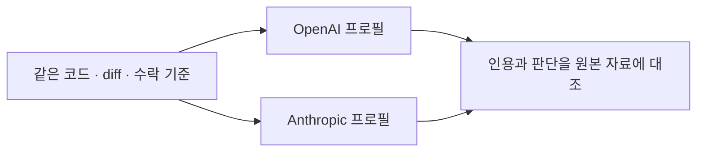

OpenAI와 Claude 요금제에서 받을 수 있는 API 크레딧을 코드 검토에 써보고 싶었습니다. 구현을 맡았던 에이전트는 그대로 두고, 같은 diff를 별도의 API 호출로 검토받으면 원래 구현에서 놓친 부분을 다시 볼 기회가 생깁니다. 두 공급자의 결과를 비교할 때는 같은 파일과 같은 수락 기준을 보내고 싶었습니다. 그 과정을 매번 손으로 준비하지 않도록 Rebut을 만들었습니다.

OpenAI의 대상 ChatGPT 요금제 혜택은 연결된 API 조직에, Claude의 대상 요금제 혜택은 Claude Console에서 쓰는 API 크레딧으로 제공됩니다. Rebut을 설정할 때는 공급자별로 크레딧이 있는 API 계정과 키를 확인해야 합니다. 사용 가능한 혜택과 잔액은 각 공급자의 계정에서 확인할 수 있습니다. [OpenAI API 크레딧 안내](https://help.openai.com/en/articles/20001626-api-credits-benefit-for-eligible-chatgpt-subscriptions) · [Claude API 과금 안내](https://support.claude.com/en/articles/9876003-why-is-claude-api-usage-billed-separately-from-my-paid-claude-plan)

## 검토에 필요한 자료를 먼저 고정합니다

Rebut은 Codex나 Claude Code에서 연결할 수 있는 MCP 서버입니다. 사용자가 고른 코드와 diff를 OpenAI 또는 Anthropic API로 보냅니다. 도구를 어느 에이전트에서 호출할지와 검토를 어느 공급자 모델에 맡길지는 별도로 선택할 수 있습니다.

리뷰를 요청하기 전에 파일과 diff, 확인할 기준을 하나의 검토 자료로 모읍니다. 예를 들어 설정 파일을 읽는 코드를 고쳤다면 “기존 설정도 읽히는가”와 “잘못된 입력은 어떻게 처리하는가”를 각각 기준으로 줄 수 있습니다. 결과 형식 v2를 쓰면 각 기준에 대한 판단과 자료의 인용 위치를 받을 수 있습니다. 응답에서 빠진 기준은 `unassessed`로 표시합니다. 인용이 가리키는 범위는 검사할 수 있지만, 그 줄에서 모델이 내린 결론이 맞는지는 원문과 실행 결과를 대조해야 합니다. [검토 결과 형식 변경 기록](https://github.com/abruption/rebut/releases/tag/v0.6.0)

두 모델 검토가 필요할 때는 `review_pair`로 같은 자료를 두 프로필에 보낼 수 있습니다. 각각 별도의 요청 ID를 쓰고, 두 리뷰어는 서로의 결과를 보지 않습니다. 공급자 API 호출마다 비용이 발생하므로 두 건의 검토를 선택한 경우에 사용합니다. 결과가 다르면 어느 쪽이 더 확신하는지보다 각 주장을 뒷받침하는 줄과 검증 방법을 먼저 봅니다. [두 프로필 검토 안내](https://github.com/abruption/rebut/blob/v0.6.1/docs/guide/ko/installation.md)

## 응답이 끊겼을 때 새 리뷰부터 돌리지 않습니다

API 응답이 끊겨도 공급자에서 검토가 끝났는지는 바로 알 수 없습니다. 그 상태에서 다른 ID로 같은 자료를 보내면 이전 요청과 별개로 처리돼 비용이 두 번 발생할 수 있습니다. 그래서 응답이 불분명하면 같은 백엔드에서 원래 요청 ID로 상태를 조회할 수 있게 했습니다. ID를 잃었을 때는 `rebut status --pending`으로 예약 또는 미확인 요청을 찾을 수 있습니다. 조회에는 모델 호출이 필요하지 않으며, 상태 조회로 유실된 검토 본문을 다시 받을 수는 없습니다.

자동화에서 특히 신경 쓴 건 “완료됐다는 정보”와 “완료된 검토 본문을 받았다”의 차이입니다. `rebut review --strict-exit`은 입력 해시와 요청한 형식에 맞는 완료 본문을 받은 경우에만 성공 종료 코드를 반환합니다. 후속 작업이 실제 결과를 받아야 진행할 수 있을 때 쓰는 옵션입니다. [요청 상태와 복구 절차](https://github.com/abruption/rebut/blob/v0.6.1/docs/guide/ko/operations.md)

## 한 장비에서 쓰는 경우와 여러 장비에서 쓰는 경우

기본 설치는 로컬 stdio로 실행하고 요청과 예산 기록은 로컬 SQLite에 둡니다. 여러 장비에서 같은 예산과 요청 기록을 보고 싶으면 Cloudflare Worker와 D1을 사용하는 방식을 선택할 수 있습니다. 어느 쪽을 쓰든 검토 자료는 선택한 모델 공급자에게 전송됩니다. 로컬 실행은 MCP 서버와 기록의 위치를 정하는 선택입니다.

공개한 0.6.1에서는 지출 한도를 조정하고 일부 모델 프로필에서 출력 상한을 더 높일 수 있게 했습니다. 긴 답이 필요한 검토를 받을 수 있는 대신 출력 상한을 올리면 요청에 예약하는 비용도 늘어납니다. 검토 범위와 예산을 같이 정할 수 있도록 두 설정을 드러냈습니다. [Rebut 0.6.1 릴리스](https://github.com/abruption/rebut/releases/tag/v0.6.1)

리뷰를 두 건 받으면 각 기준을 어디까지 확인했는지부터 봅니다. 답변에 적힌 인용을 원본에 대조하고, 두 모델 모두 판단을 빠뜨린 기준이 있다면 그 부분은 직접 확인해야 합니다.

- [Rebut 저장소](https://github.com/abruption/rebut)
- [설치 및 사용 가이드](https://github.com/abruption/rebut/blob/v0.6.1/docs/guide/ko/installation.md)
